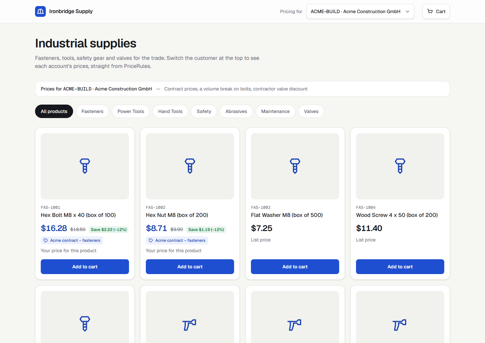
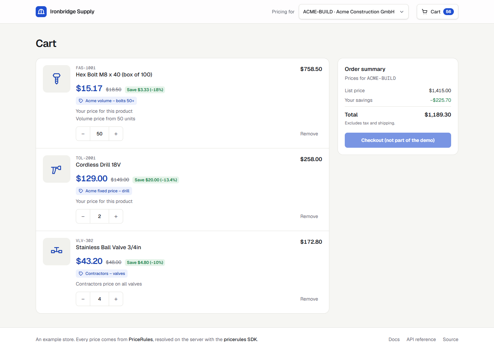

# PriceRules Next.js example: a B2B portal with customer-specific prices

A small B2B store built with Next.js that shows each customer their own prices, resolved by [PriceRules](https://pricerules.app) through the official [`pricerules`](https://www.npmjs.com/package/pricerules) SDK. Switch between customers and watch contract prices, group discounts, volume breaks and dated promotions change the catalog and the cart.

[](https://vercel.com/new/clone?repository-url=https%3A%2F%2Fgithub.com%2Fdalisraieb%2Fpricerules-nextjs-example&env=PRICERULES_API_KEY&envDescription=Your%20PriceRules%20API%20key%20(dashboard%20%E2%86%92%20API%20%E2%86%92%20Create%20key)&envLink=https%3A%2F%2Fpricerules.app%2Fdocs%2Fsdk&project-name=pricerules-nextjs-example&repository-name=pricerules-nextjs-example)



## What it shows

- **A catalog priced per customer.** Every product on the page is priced in one `resolve()` call for the selected customer. Each card shows the final price, the base price struck through, the saving, the rule that applied (`applied_rule.name`), why it applied (`match_reason` in plain words) and "Contract price until …" when the rule has a `valid_to`.
- **A customer switcher** with accounts from PriceRules' sample data:
  - `ACME-BUILD`: contract prices, a volume break on bolts at 50 units, and the Contractors group's valve discount.
  - `SUMMIT-ENG`: another contractor, so the same group discount, plus bulk gloves from 100.
  - `HARBOR-SUP`: a promotion with an end date.
  - Guest: no customer, so list prices.
  - Any other code: try `NEW-CO` to see how an unknown customer is handled.
- **Price by quantity** on each product page: the same SKU at 1, 5, 10, 20, 50 and 100 units, in one call.
- **A cart that prices every line in one call.** The browser posts SKUs and quantities to this app's `/api/cart`, which calls PriceRules. Raise the bolts from 49 to 50 for `ACME-BUILD` and the line drops from 12% to 18% off.
- **Graceful handling** of everything that isn't a clean price:
  - An unknown customer (the `CUSTOMER_NOT_FOUND` warning): list prices plus a notice.
  - A product PriceRules doesn't have (`PRODUCT_NOT_FOUND`): the "new arrival" `VLV-350` shows "Price on request".
  - A `PriceRulesError`: "Prices unavailable", with the error code, the request id to quote to support, and Try again.
  - A missing API key: a setup notice instead of a crash.



## Run it

1. **Get a PriceRules API key for a workspace with the sample data.** In [PriceRules](https://pricerules.app), choose the sample data during onboarding (or use **Load sample data** in the Pricing Sandbox), then create a key on the **API** page.
2. **Add the key:**
   ```bash
   cp .env.example .env.local   # then set PRICERULES_API_KEY=…
   ```
3. **Start the store:**
   ```bash
   npm install
   npm run dev
   ```
   Open http://localhost:3000.

Node 20.9 or later.

## How it works

The API key stays on the server. The browser never calls PriceRules.

| File | What it does |
| --- | --- |
| [`lib/pricerules.ts`](lib/pricerules.ts) | The only module that talks to PriceRules: the SDK client and `priceLines(customer, lines)`, which turns any `PriceRulesError` into something the page can show. It imports `server-only`, so it can't end up in browser code. |
| [`app/page.tsx`](app/page.tsx) | The catalog. A Server Component prices the visible products in one call while it renders. |
| [`app/products/[sku]/page.tsx`](app/products/%5Bsku%5D/page.tsx) | A product page with price by quantity. |
| [`app/api/cart/route.ts`](app/api/cart/route.ts) | The cart's backend: validates the lines and prices them in one call for the customer in the cookie. |
| [`components/cart-view.tsx`](components/cart-view.tsx) | The cart in the browser: re-prices through `/api/cart` whenever a line or the customer changes. |
| [`lib/explain.ts`](lib/explain.ts) | Turns a resolved item into what a buyer reads: the saving, `match_reason` in plain words, the volume and end-date notes. |
| [`lib/catalog.ts`](lib/catalog.ts) | The store's own product data (names, categories). Prices come only from PriceRules. |

The selected customer is kept in a cookie so pages can price on the server. In a real portal, take the customer code from the signed-in user's company instead, never from anything the buyer can edit.

## Learn more

- [SDK documentation](https://pricerules.app/docs/sdk) and [source](https://github.com/dalisraieb/pricerules-node)
- [API reference](https://pricerules.app/docs/api-reference): the response fields, match reasons and error codes
- [PriceRules docs](https://pricerules.app/docs)

## License

[MIT](LICENSE)
